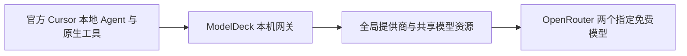

# Cursor 原生本地 API 试验

2026-10-07，macOS arm64。官方 `agent-cli-local` June 12 包的本地引擎，使用实际 ModelDeck apply、协议网关和原生工具。完整结果见 [summary.json](summary.json)。

| 验证项 | 结果 | 证据 |
| --- | --- | --- |
| 无 Cursor 账号的原生本地模型调用 | 通过 | [mock](results/mock.json) |
| 原生 Read / Write 完整工具往返 | 本机模拟模型通过，未计入真实模型矩阵 | [mock-tools](results/mock-tools.json) |
| 实际 ModelDeck 生成的启动器 | apply 通过，CLI 使用 `/deck-clients/cursor-agent` | [Inkling](results/managed-inkling.json) |
| 原生 `--list-models` | 正常退出，包含 `md-nemotron`、`md-inkling` | [catalog](results/managed-catalog-final.json) |
| Inkling free 完整工具任务 | 通过；原生 Read、Shell 写入 `89`、Read 校验、最终 `MD_TEST_OK`，exit 0，39.29 秒 | [结果](results/managed-inkling.json)、[日志](logs/managed-inkling.log) |
| Nemotron free 完整工具任务 | 未完成；最新三次推理请求均返回 Nvidia 流内 503 | [结果及原始错误](results/managed-nemotron.json) |
| 早期 Nemotron 部分成功 | 原生读取和写入 `89` 成功，最终回复遇到 503，exit 1；不计通过 | [部分成功](results/nemotron-native-retries.json) |
| Cursor GUI 本地路径 | 当前构建包含引擎，但编译开关为关闭；尚未执行无登录 GUI 会话 | [源码检查记录](gui-inspection.json) |

本地链路为：



使用空白私有配置和数据目录，没有提供 Cursor 账号 key、access token 或 refresh token。测试预加载器拦截并记录非本机网络；模型请求均发向 loopback，未发生 Cursor 账号后端请求。CLI 的语言工具曾尝试下载 TypeScript language server，该下载被测试拦截，未影响完整任务。原生初始化事件的通用 `apiKeySource: login` 字段仍存在；它并不证明登录被使用，实际隔离配置、凭据环境和网络记录在这里提供独立证据。

Inkling 最初返回 agentic-harness 准入 403。为真实 Cursor CLI 补齐 `HTTP-Referer: https://cursor.com`、`X-OpenRouter-Title: ModelDeck / Cursor CLI Local`、CLI 类别信息后，诊断返回 200，随后完整原生工具任务通过。原生 `Cursor-CLI/...` User-Agent 保持原样。六份 Inkling usage 记录的 cost 均为 0；本轮没有免费额度 429，付费回退调用为 0。

提供商密钥只在 ModelDeck 网关进程中解析。CLI 仅收到专属网关 token；启动器和命令参数不含密钥。安装的原始 Cursor CLI 和 GUI 文件未被改写，也未修改账号、订阅或额度状态。ModelDeck 适配器只注入本地连接信息、加载共享模型列表，并调用官方 authless 模式和本地引擎。

源码接入包括本地包的 checksum manifest、按实际运行版本选择本机或公网地址、原生模型发现、原生 `--list-models` 投影，以及真实应用归属头。普通 Cursor 云端 CLI 与 GUI 的公网 HTTPS 约束保持有效；未验证的可执行文件不能仅靠文件名获得本地模式。

官方包来源及 SHA256 见 [vendor-source.json](vendor-source.json)。本地包保留在工作区的 `.build/cursor-direct/vendor`，未安装为全局命令。当前已验证的原生可执行文件为：

```text
/Users/vita/Others/ModelDeck/.build/cursor-direct/vendor/2026.06.12-19-59-36-f6aba9a/dist-package/cursor-agent-local
```

在新版 ModelDeck 的 Cursor CLI 页面将该路径填入可执行文件字段，选择提供商端点和默认模型，保存并应用，再使用生成的受管启动命令。源码中的 `.cjs` 只修改该启动进程的模型连接和目录行为。

测试入口为 `live-gateway.py prepare` / `live-gateway.py serve`，启动随机本机端口的实际生产网关。通过 `/__test/apply` 选择 `cursor-agent` 与 `nemotron` 或 `inkling`，再使用 `probe.py --managed-command <生成的启动器> --base-url <测试地址> --token-file <私有入口token文件> --tools --case <名称> --model md-inkling`。`--list-models` 验证原生目录。复跑需要已授权的 `OC_OR_KEY` 和 `vendor-source.json` 对应官方包；测试结束后私有运行目录已清理。

[gateway-records.jsonl](gateway-records.jsonl) 保存无凭据的请求路径、原生 User-Agent、工具名和状态。报告中 HTTP 200 的 SSE 仍可能包含 503 错误，结果依据实际工具完成、文件值、终止标记及退出码判定。[protected-config-check.json](protected-config-check.json) 和 [cleanup.json](cleanup.json) 记录正式配置保护与临时会话清理。
